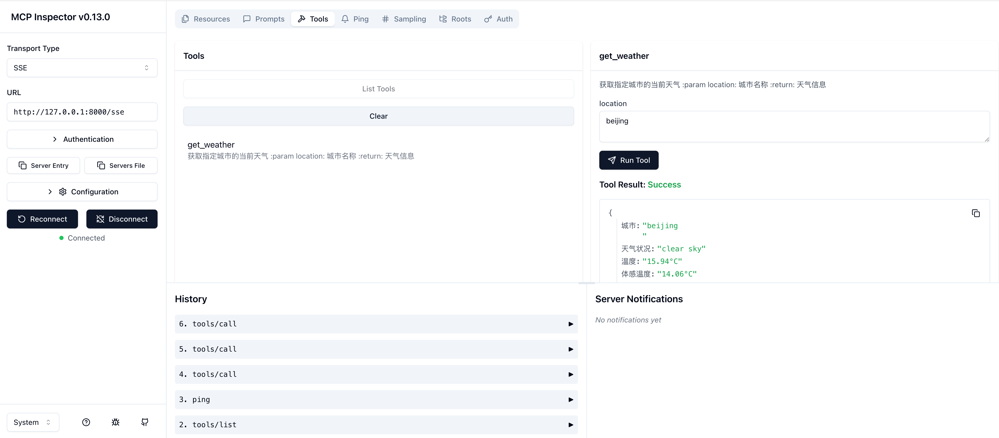

## 项目结构

本项目包含三个主要文件夹，分别实现了不同功能：

- **doc**: MCP (Model Context Protocol) 的详细解读文档和说明
- **mysql**: 使用 stdio 模式实现的 MySQL MCP 服务
- **weather**: 使用 HTTP SSE 模式实现的天气 MCP 服务示例

## MCP Inspector 界面展示

*上图展示了 MCP Inspector 工具界面，可以看到天气服务工具的调用和结果展示*

